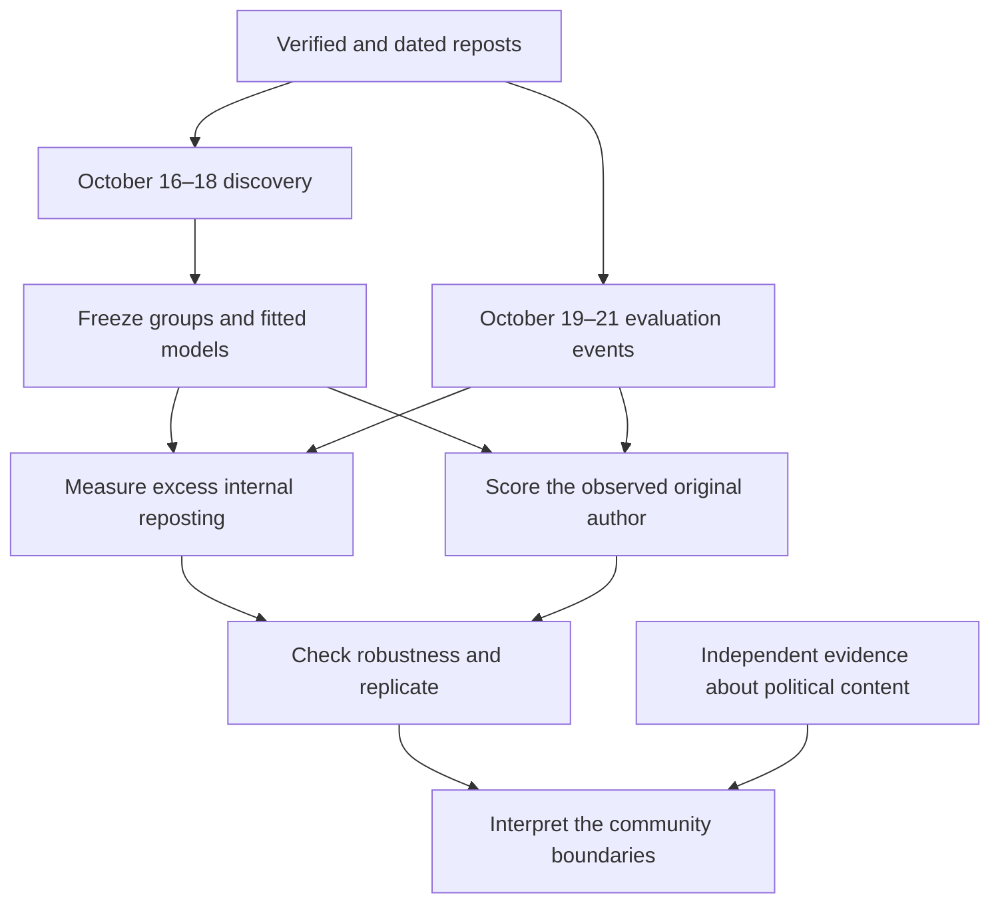

# From election reposts to a test of what communities predict

**Prospective thesis pipeline · M3 design note · 2026-11-26**

If we know which community an account belonged to during the first three days of observation, how much more can we say about whose work it amplifies in the following three days? A second question connects this computational task to the earlier hashtag study. Do the same boundaries distinguish the political material that people write or share?

The proposed thesis has two primary outputs. One is the **percentage-point excess in internal reposting** above a reference that preserves activity and item popularity. The other is the **change in predictive log score** when community membership is added to a model that already knows prior sharing relationships. Either estimate can be close to zero. An optional content study examines what a structural boundary means in Brazilian political discourse. The registered M3 protocol governs the pilot. The extensions and examples below describe possible later work. [M3 protocol v1](m3-repost-pilot-specification.md) · [Research assessment](research-seed-assessment.md)

## Pipeline at a glance

The [November 26 implementation checkpoint](m3-discovery-implementation.md) reports a reconciled discovery ledger, verified directed optimizers, small reference and prediction tests, and empirical calibration of the context and prior-tie models. Community fitting and the corpus-scale reference checks were ongoing. The frozen partition, community coefficient and substantive holdout results were pending at the [reviewed revision](https://github.com/BCIrealm087/masters-echochambers/tree/678b5ea454bbe71d26b03354a8442779b69ddc8f).

## 1. Turn Parquet rows into a historical event ledger

The raw unit is a stored copy. The analytic unit is one **observed repost action**. For the structural pilot, read the four Lula and Bolsonaro ordinary and repost contexts on the Ubuntu data host. Track the input snapshot, selected columns and file membership. Use the explicit interaction type to select reposts. Parse the action timestamp, check agreement with the post ID clock at whole-second precision, and assign its date in `America/Sao_Paulo`. Folder dates locate files. In the real audit, 354,001 copies stored under October 23 recorded actions on October 21. Filtering solely on folder date would have dropped those observations.

Deduplicate by action ID while retaining every query membership. If the same ID appears in both candidate contexts, its single event belongs to the overlap stratum. A second action by the same sharer is a separate event. Join the referenced original-post ID to its historical author across all relevant tweet files, including records outside the action window. Those records may establish identity. Later activity, popularity and content statistics enter neither the discovery graph nor the fitted predictor. [M2 audit and coverage table](m2-repost-coverage-audit.md#what-did-we-learn)

| Private ledger field | What it means downstream |
| --- | --- |
| Action ID, timestamp, local date, interaction type | Distinguish repeated collection from repeated behavior and place each verified action in its correct window. |
| Sharer ID, referenced original ID, historical original-author ID | Identify who amplified whom and which exact item circulated. Keep the item ID when its author is unresolved. |
| Query memberships and reconciliation flags | Define disjoint Lula-only, Bolsonaro-only and overlap contexts. Preserve missing or conflicting fields, source lookup status and verified self-reposts for the relevant denominators. |

| Recorded checkpoint | Count |
| --- | ---: |
| Distinct verified reposts, October 16–21 | 11,988,989 |
| Six-day reposts with both accounts resolved | 11,960,224 (99.760%) |
| Distinct verified reposts, October 16–18 | 6,800,676 |
| Discovery actions with unresolved original authors | 22,464 |
| Verified discovery self-reposts | 13,284 |
| Eligible non-self discovery actions | 6,764,928 |
| October 19–21 actions with both accounts resolved before M3 exclusions | 5,182,012 |

The final evaluation denominator also depends on self-repost exclusions and discovery group assignments. Event recovery and item recovery tell different stories. Historical authors were recovered for 98.390% of distinct referenced posts, and rare originals had lower recovery. The size of the never-collected population remains unknown. [M2 results](m2-repost-coverage-audit.md#what-did-we-learn) · [Discovery reconciliation](m3-discovery-implementation.md#discovery-population)

## 2. Set the time boundaries before learning from the data

| Use | Fit with | Evaluate or select with |
| --- | --- | --- |
| Discovery calibration, fold 1 | October 16 | October 17 |
| Discovery calibration, fold 2 | October 16–17 | October 18 |
| Final discovery fit | October 16–18 | Discovery-only stability, feasibility and calibration criteria |
| Primary held-out comparison | Frozen groups and model parameters through October 18 | October 19–21, after the freeze |
| Possible replication | The original frozen choices or a prespecified rolling refit | A separately chosen untouched period |

Each rolling fold must discover its own groups using the training prefix. Giving the first fold a partition built with October 17–18 activity would let its validation actions influence the feature being evaluated. The six-day coverage audit can inspect dates and linkage across both intervals. Selecting graph settings by their October 19–21 enrichment would spend that interval as development data. A redesigned analysis would require a fresh evaluation window. [Temporal and fitting rules](m3-repost-pilot-specification.md)

## 3. Build the account graph and discover communities

Create one vertex per incident account and one directed edge from sharer to original author. Its weight counts distinct eligible discovery reposts between those accounts. Include disconnected components. Fit the binary version on the same vertices and edges, assigning weight one to each distinct relationship. This makes it possible to ask how much a partition depends on repeated amplification.

Two implementation checks tie that graph to its measurement. The private action ledger must contain each retained action ID once, and the sum of edge weights must equal 6,764,928 for the registered discovery cohort. An indexed lookup with one accepted author per original prevents duplicate historical source rows from multiplying edges. Column-wise scans, a sparse edge list and aggregation of repeated source-choice calculations make the experiment practical without materializing every possible account pair.

For a synthetic example, account A reposts post X by B. The same action appears in both candidate queries. It adds one unit to A → B. Later A reposts post Y, also by B. The edge now has weight two. An account-to-post graph retains the separate edges A → X and A → Y. In a circulation table the words or material originate with B and are amplified by A. Keeping these directions and units explicit prevents a high-volume producer from being mistaken for an account that reposts widely.

The registered primary optimizer is directed weighted Leiden. Compare directed Louvain on the same modularity objective and directed Infomap as a flow-based comparison. Evaluate six resolutions from 0.5 through 2 and 20 seeds in the modularity grids. Apply the protocol’s connectivity, minimum group size/activity and run-eligibility rules. Choose the eligible resolution with the best median agreement across runs, measured by adjusted Rand index. Select a representative run by its agreement with the other eligible runs. Record ties, splits, merges, sizes and coverage. Agreement measures repeatability. An independent test is needed to interpret a group politically.

Refit after removing each discovery day and after excluding the most amplified discovery accounts. Compare binary and weighted partitions. These changes ask whether the groups themselves survive. Later removal of a viral post from held-out scoring asks whether that post drove the measured effect for already frozen groups. [Discovery benchmark](reflexive-report-6.md) · [Registered selection and fallback rules](m3-repost-pilot-specification.md#choose-and-freeze-the-discovery-partition)

## 4. Fit four models of original-author choice

One prediction case is a verified eligible repost by sharer `u`, at time `t`, in collection context `c`. The target is the **historical author of the reposted original**. Each model assigns probabilities to the same candidate authors for that event. The endpoint is conditional on a repost already having occurred.

| Model | Information supplied | Question it answers |
| --- | --- | --- |
| Global popularity | Smoothed counts of original authors amplified during discovery | How far does general popularity carry the prediction? |
| Context popularity | Author counts within query context, backed off to global popularity | How much does collection composition explain? |
| Prior ties | Each sharer’s frequency and recency of reposting each author, pooling ties across contexts and backing off to context popularity | How well can habitual sharing predict the source? |
| Prior ties plus group membership | The identical fitted prior-tie distribution and one coefficient for shared frozen membership | How much does group information add when the sharer’s history is already known? |

The primary candidate set is the union of discovery authors and resolved authors appearing in the evaluation day and context, excluding the sharer. This uses later **presence** to define a retrospective choice set. All learned counts and weights come from discovery. M3 also specifies a discovery-only candidate set with a single category for previously unseen authors. Report both with their respective meanings. A live forecasting design would need to define eligible sources using only information available before the action. Neither candidate list is a record of feed impressions.

Let $q_H(a)$ be the prior-tie model’s probability for candidate author $a$ for this event. Let $I(u,a)$ be one when both accounts have the same assigned group and zero otherwise. The group model is

$$
q_G(a)=\frac{q_H(a)\exp(\beta I(u,a))}
{\sum_{b \in C} q_H(b)\exp(\beta I(u,b))}.
$$

Here $C$ is the common candidate set for the event. A zero coefficient reproduces the history model exactly. A positive value increases the relative weight of authors in the sharer’s group. A negative value reduces it. Smoothing gives previously unseen relationships a chance and keeps the log score finite.

Tune context smoothing, then dyad smoothing and recency, then the group coefficient, using the two rolling discovery folds. The registered grids allow prior masses 1, 10 and 100, decay half-lives of one day, three days or infinity, and a group coefficient grid including zero and both signs. The recorded context and dyad stages selected masses of 100 and a one-day half-life across **3,570,755 discovery validation actions**. The group coefficient still needed the fold partitions at this checkpoint. If neither fold yields an eligible partition, the registered fallback is zero with the incremental group comparison flagged as uncalibrated. [Prediction specification](m3-repost-pilot-specification.md#prediction-beyond-prior-ties) · [Calibration checkpoint](m3-discovery-implementation.md#discovery-fitting-checkpoint)

## 5. Verify the comparisons and freeze the run

Check the direction and normalization of the graph objective on a graph small enough to calculate by hand. Verify both probability models on tiny ledgers, including unseen authors, exclusion of the sharer and probabilities summing to one. The Ubuntu implementation has passed small fixtures for these properties. Exact enumeration on small cases provides a reference against which a larger randomization algorithm can be checked. The implementation report explicitly flags corpus-scale sampling as an outstanding task.

Use discovery-based simulations with known null effects and injected group affinity to check false positives, sensitivity and power under viral originals, repeated ties and unequal activity. The protocol budgets roughly 1,000 simulated ledgers per scenario. Before using held-out group outcomes, archive the eligibility rules, hashes of the input and partitions, model settings, candidate rules, parameter choices, tested reference implementation, software versions and code revision. Record seeds, runtimes and memory requirements. The private ledger and memberships stay on the Ubuntu host. The executable manifest and reviewed aggregates make the experiment reproducible. [Implementation checks](m3-discovery-implementation.md#implementation-checks) · [Freeze and inference rules](m3-repost-pilot-specification.md)

## 6. Evaluate two questions on the later dates

### A. Does internal reposting exceed what the observed margins predict?

Use verified non-self reposts from assigned sharers with resolved authors and known provenance. An identified author outside the discovery partition counts as external. A missing author contributes to coverage and bounds. An unassigned sharer does not enter the primary group estimate. Report each category.

Count the share of eligible actions for which both endpoints have the same frozen group. For the matched reference, keep each sharer’s action times and activity and each original post’s repost volume fixed within each day and disjoint query context. Reallocate original posts to feasible action slots. Exclude self-reposts and assignments before a post was published. Respect observed multiplicities and any independently verified uniqueness constraint. This answers what concentration is left after controlling for the popularity of the particular items in circulation.

$$
\Delta_{\rm pp}=100\left(S_{\rm observed}-\mathbb{E}_{\rm reference}[S]\right).
$$

For illustration, an observed share of 0.68 and a mean reference share of 0.60 give an excess of **8 percentage points**. Its evidential strength depends on the reference distribution, uncertainty and sensitivity. M3 registers a one-sided global test at 0.05 and a provisional practical screen of +5 points, with alternative screens. Give absolute shares, effect size, central 95% reference range and Monte Carlo uncertainty. The reference range describes variation under the reallocation model. A confidence interval for generalization requires its own assumptions.

Check that the sampler preserves the margins, reaches the required legal allocations and has acceptable mixing. Include immobile strata at their fixed contribution. Use the plus-one tail estimate for independent simulations, with 9,999 draws where feasible. Dependence between draws requires its own diagnostics and effective simulation size. If a valid corpus-scale reference cannot be established, report the descriptive shares and the feasibility limit. For local group claims, apply Holm correction to the registered family with at least 100 eligible actions from 20 distinct sharers per group. A global result alone describes the partition. [Holdout inference](m3-repost-pilot-specification.md#holdout-inference) · [Hobson et al. on network reference models](https://doi.org/10.1111/brv.12775)

### B. Does knowing the group improve prediction of the actual author?

For each eligible action, look up the probability each frozen model assigned to the observed author. Compare the two strongest models on exactly the same actions and candidate sets. With natural logarithms, the mean paired gain is

$$
G=\frac{1}{N}\sum_{e=1}^{N}
\log\frac{q_G(a_e\mid u_e,t_e,c_e)}{q_H(a_e\mid u_e,t_e,c_e)}.
$$

**Worked example with fictional probabilities.** Suppose the history model gives B, C and D probabilities 0.30, 0.50 and 0.20. Only B shares the sharer’s group. With an illustrative coefficient of 1, the normalized group-model probabilities are approximately 0.538, 0.330 and 0.132. If the real destination of this fictional action is B, the gain is about +0.584 nats. If it is C, the gain is about −0.416 nats. A model pays for increasing B’s probability whenever the observed source falls elsewhere. The average over all scored actions determines the result.

Report each model’s mean log score and paired gain, with uncertainty clustered by sharer and checks for dependence on highly reused posts or authors. A positive $G$ means a higher geometric-mean probability assigned to the realized sources. Break it down by day, query and whether the sharer–author pair was observed in discovery. Gain on previously unseen pairs is particularly informative about what the group generalizes beyond a repeated connection. The coefficient’s sign tells whether common membership raises or lowers the source weight. This calculation uses a different comparator from $\Delta_{\rm pp}$, so the results can differ. [Prediction and uncertainty](m3-repost-pilot-specification.md#prediction-beyond-prior-ties) · [Gneiting and Raftery on probabilistic scoring](https://doi.org/10.1198/016214506000001437)

## 7. Stress-test the interpretation and seek replication

- **Who drives the result?** Compare event-weighted results with equal-sharer and distinct-pair estimates. Remove top posts and authors and recompute the matched reference on the retained events. Report how much weight belonged to the largest sources.
- **Are familiar items being recirculated?** Examine previously observed versus new sharer–author pairs, and distinguish an original first seen in this archive from an original verified as newly published. Persistence across new pairs and new items would broaden the interpretation beyond repetition of the same relationships or messages.
- **Which observations are missing?** Among assigned sharers, bound the raw internal share by assigning all otherwise eligible unknown destinations first external and then internal. For excess over reference, vary historical author assignments consistently for each original post, recompute the expected share on the same completed events, and refit discovery if its inputs change. The M2 recovery percentage covers observed records only.
- **How persistent are the boundaries?** Examine the registered day, context, weight, hub and method sensitivities. Discovery includes the runoff debate and its aftermath. To test the lifespan of these particular groups, carry the same memberships into an untouched period. To test the repeatability of the method, discover new groups in another earlier window and use its own later window. Report these as different replication targets. [Sensitivity rules](m3-repost-pilot-specification.md#missingness-concentration-and-decisions) · [Temporal interpretation](reflexive-report-5.md#what-could-overturn-the-interpretation)

| Possible result after adequate checks | Interpretation |
| --- | --- |
| Material internal excess and robust positive predictive gain with positive group coefficient | The frozen groups capture a recurring sharing pattern and add information about source choice beyond recorded ties in this sample. |
| Material excess and precisely negligible gain | The groups describe concentrated circulation. Familiar relationships and context already capture most of the information supplied by the membership feature in this model. |
| Weak global excess and reproducible predictive gain | Inspect the coefficient’s sign and the prespecified breakdowns. A feature can improve source choice in particular contexts or favor cross-group destinations without showing broad excess internal sharing. |
| Both effects precisely small, estimates fragile, or uncertainty large | Precise small effects bound the groups’ usefulness for these tasks. Effects confined to a hub or day support a narrower finding. Wide uncertainty or an invalid reference leaves the corresponding question open. |

## 8. Find out what crossed the boundary

The researcher's observation of culturally distinct hashtag clusters motivates a further test. Earlier linguistic repertoires can be compared with repost communities, added to graph representations or used as features in the author-choice model. The [prospective repertoire study](linguistic-repertoire-hypothesis.md) sets out separate evaluations for each use.

**First structural extension.** Construct a bipartite graph of frozen-group sharers and distinct original posts. For each pair of groups, measure overlap in exact originals and compare it with a reference preserving each sharer’s number of distinct originals and each item’s distinct audience size. A post with a known ID but unresolved author can enter this analysis if the sharer has an independently established discovery assignment. Report the change in coverage. Repertoire overlap, author flow and event volume can tell different stories. Two groups may favor different authors while both circulate reports on the same debate. Identifying common themes across different posts takes content evidence. [Circulation design](reflexive-report-3.md)

**Selected language extension.** Ask, separately for Lula and Bolsonaro, whether candidate criticism is widespread in members’ own writing or gains prominence through repeated sharing of a few originals. The host schema includes text fields. M2 validated linkage, while the fraction of recoverable, attributable and codable Portuguese text by group, time and interaction type still needs measurement. If coverage permits, use the following sequence.

1. Sample authored passages and amplified originals across frozen groups, dates, candidate targets and post types, including ordinary as well as viral items. Retain inclusion probabilities and missing-context reasons. For quotes or replies, recover speaking turns where possible.
2. Have independent Brazilian Portuguese readers label speaker, candidate target, expressed stance and criticism or personal attack. A quoted accusation in a news report can have a different speaker from the reporter. Mark mixed uses, irony and insufficient context explicitly. Blind reference coders to community membership and model suggestions.
3. Compare transparent rules or TF–IDF with a linear classifier against a Portuguese encoder on the same independently labeled examples. The prior hashtag-propagation model supplies a candidate-relative baseline where tag labels and inputs are available. Keep the distinction between a hashtag’s conventional meaning and its use in a particular post. Freeze development choices, separate authors, source originals and near-duplicates across splits where feasible, and check transfer to another period.
4. Report annotator agreement, per-label precision and recall, macro-F1, calibration and accuracy at the retained coverage if the classifier can abstain. Inspect errors by group, candidate and post type before estimating differences. Compare estimates from the annotated sample with automated estimates where feasible. Uneven errors can produce an apparent political asymmetry.
5. For each group estimate prevalence four ways. Weight by authored posts, by participating authors, by distinct amplified originals and by repost events. Standardize for day, topic and target where data overlap. A contrast appearing mainly in the event-weighted estimate points toward disproportionate visibility of a few originals. A contrast reproduced across authors’ own writing supports a broader discourse finding. [Portuguese annotation and estimation](reflexive-report-2.md) · [Prior stance baseline](reflexive-report-4.md)

**Optional model comparisons.** A graph neural network could be evaluated as an additional source-choice predictor with identical temporal splits, candidate sets, information cutoffs and scoring. A language model could compete in the stance benchmark or explain fixed evidence records against a deterministic Portuguese summary. Multimodal analysis would become relevant if an error audit implicated missing visual context and enough original media were available. Each extension would need to demonstrate a specific gain over its simpler baseline. [Graph benchmark](reflexive-report-6.md) · [Grounded explanations](reflexive-report-1.md)

## What the thesis would deliver

A finished structural study would include the reproducible event audit, a documented graph representation, a frozen partition with stability evidence, the matched-reference effect, the incremental source-prediction score, and a record of when conclusions change. An independent political content study would add evidence about what circulates and how broadly particular positions are expressed.

For an individual community, a reader should be able to open one record and see its stability across discovery runs, covered sharers and eligible actions, observed and expected internal shares, group-specific uncertainty and adjusted test, contributions of its largest sources, and the volume going to other groups. Independent discourse estimates can be added with their own coverage and disagreement. Include a fragile or mixed case alongside stronger cases so readers can see where a group interpretation breaks down. The final political description should be traceable to these measurements. [Expert review design](m1-expert-validation.md)

Persistent internal amplification is a behavioral result. Political alignment needs independent stance or source evidence. The project’s stronger term *selective-sharing echo-chamber candidate* additionally requires evidence about comparable opposing material that members had the opportunity to share. Claims about feed exposure, belief change or private trust require other observations. A finding that the observed social boundaries predict little about political content would itself answer the thesis question. [Interpretation criteria](reflexive-report-8.md#research-questions-and-evidence-needed-to-answer-them)
